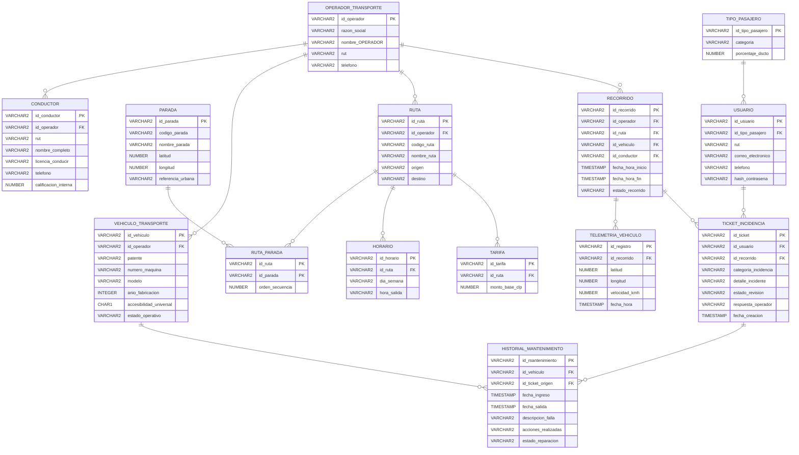

# Entregable Taller Preparatorio — Evaluación 1

**Proyecto:** Turecorrido
**Rubro:** Logística / Transporte
**Fecha:** 10 de septiembre de 2026

## Integrantes

1. VICENTE HERRERA
2. NICOLAS  IRARRAZABAL

---

## 1. Contexto del Negocio

### Descripción del Negocio
TuRecorrido es una plataforma digital de gestión para el transporte público en Chile. El sistema conecta a pasajeros/usuarios, conductores de microbuses, empresas operadoras de transporte y administradores de fiscalización. A través de la plataforma, los usuarios consultan recorridos y paradas en tiempo real, y reportan incidencias sobre el servicio o la flota.

### Problema que Resuelve
Actualmente existe poca información clara sobre horarios, rutas y paradas del transporte público en Puerto Montt y Puerto Varas, además de pocos canales formales para realizar reclamos.

El proyecto busca centralizar esta información y facilitar el reporte de problemas, con un enfoque accesible y con respaldo comunal e institucional.

### Objetivo del Sistema
La solución en PL/SQL automatizará principalmente:

Gestión de incidencias: registro, actualización y detección de reclamos recurrentes.
Procesamiento de telemetría: cálculo de velocidad promedio, detección de desvíos y control de horarios.
Cálculo de tarifas y evaluaciones: asignación automática de tarifas y actualización de la calificación de conductores.
Validación de datos: control de reglas del negocio y manejo de errores, como RUT inválidos o cambios de estado no permitidos.

---

## 2. Modelo de Datos

### Entidades y Atributos

#### OPERADOR_TRANSPORTE
> Empresas operadoras del servicio

| Atributo | Tipo | PK | FK → | NOT NULL | UNIQUE |
|----------|------|----|------|----------|--------|
| id_operador | VARCHAR2 | ✓ |  | ✓ |  |
| razon_social | VARCHAR2 |  |  | ✓ |  |
| nombre_OPERADOR | VARCHAR2 |  |  | ✓ |  |
| rut | VARCHAR2 |  |  | ✓ | ✓ |
| telefono | VARCHAR2 |  |  |  |  |

#### TIPO_PASAJERO
> Categorías de tarifas para usuarios

| Atributo | Tipo | PK | FK → | NOT NULL | UNIQUE |
|----------|------|----|------|----------|--------|
| id_tipo_pasajero | VARCHAR2 | ✓ |  | ✓ |  |
| categoria | VARCHAR2 |  |  | ✓ |  |
| porcentaje_dscto | NUMBER |  |  | ✓ |  |

#### USUARIO
> Pasajeros registrados en el sistema

| Atributo | Tipo | PK | FK → | NOT NULL | UNIQUE |
|----------|------|----|------|----------|--------|
| id_usuario | VARCHAR2 | ✓ |  | ✓ |  |
| id_tipo_pasajero | VARCHAR2 |  | TIPO_PASAJERO | ✓ |  |
| rut | VARCHAR2 |  |  | ✓ | ✓ |
| correo_electronico | VARCHAR2 |  |  | ✓ | ✓ |
| telefono | VARCHAR2 |  |  |  |  |
| hash_contrasena | VARCHAR2 |  |  | ✓ |  |

#### PARADA
> Puntos de detención físicos

| Atributo | Tipo | PK | FK → | NOT NULL | UNIQUE |
|----------|------|----|------|----------|--------|
| id_parada | VARCHAR2 | ✓ |  | ✓ |  |
| codigo_parada | VARCHAR2 |  |  | ✓ | ✓ |
| nombre_parada | VARCHAR2 |  |  | ✓ |  |
| latitud | NUMBER |  |  | ✓ |  |
| longitud | NUMBER |  |  | ✓ |  |
| referencia_urbana | VARCHAR2 |  |  |  |  |

#### CONDUCTOR
> Choferes asignados

| Atributo | Tipo | PK | FK → | NOT NULL | UNIQUE |
|----------|------|----|------|----------|--------|
| id_conductor | VARCHAR2 | ✓ |  | ✓ | ✓ (Comp.) |
| id_operador | VARCHAR2 |  | OPERADOR_TRANSPORTE | ✓ | ✓ (Comp.) |
| rut | VARCHAR2 |  |  | ✓ | ✓ |
| nombre_completo | VARCHAR2 |  |  | ✓ |  |
| licencia_conducir | VARCHAR2 |  |  | ✓ | ✓ |
| telefono | VARCHAR2 |  |  |  |  |
| calificacion_interna | NUMBER |  |  | ✓ |  |

#### VEHICULO_TRANSPORTE
| Atributo | Tipo | PK | FK → | NOT NULL | UNIQUE |
|----------|------|----|------|----------|--------|
| id_vehiculo | VARCHAR2 | ✓ |  | ✓ | ✓ (Comp.) |
| id_operador | VARCHAR2 |  | OPERADOR_TRANSPORTE | ✓ | ✓ (Comp.) |
| patente | VARCHAR2 |  |  | ✓ | ✓ |
| numero_maquina | VARCHAR2 |  |  | ✓ |  |
| modelo | VARCHAR2 |  |  |  |  |
| anio_fabricacion | INTEGER |  |  |  |  |
| accesibilidad_universal | CHAR(1) |  |  | ✓ |  |
| estado_operativo | VARCHAR2 |  |  | ✓ |  |

#### RUTA
| Atributo | Tipo | PK | FK → | NOT NULL | UNIQUE |
|----------|------|----|------|----------|--------|
| id_ruta | VARCHAR2 | ✓ |  | ✓ | ✓ (Comp.) |
| id_operador | VARCHAR2 |  | OPERADOR_TRANSPORTE | ✓ | ✓ (Comp.) |
| codigo_ruta | VARCHAR2 |  |  | ✓ | ✓ |
| nombre_ruta | VARCHAR2 |  |  | ✓ |  |
| origen | VARCHAR2 |  |  | ✓ |  |
| destino | VARCHAR2 |  |  | ✓ |  |

#### RUTA_PARADA
| Atributo | Tipo | PK | FK → | NOT NULL | UNIQUE |
|----------|------|----|------|----------|--------|
| id_ruta | VARCHAR2 | ✓ | RUTA | ✓ | ✓ (Comp.) |
| id_parada | VARCHAR2 | ✓ | PARADA | ✓ |  |
| orden_secuencia | NUMBER |  |  | ✓ | ✓ (Comp.) |

#### HORARIO
| Atributo | Tipo | PK | FK → | NOT NULL | UNIQUE |
|----------|------|----|------|----------|--------|
| id_horario | VARCHAR2 | ✓ |  | ✓ |  |
| id_ruta | VARCHAR2 |  | RUTA | ✓ | ✓ (Comp.) |
| dia_semana | VARCHAR2 |  |  | ✓ | ✓ (Comp.) |
| hora_salida | VARCHAR2 |  |  | ✓ | ✓ (Comp.) |

#### TARIFA
| Atributo | Tipo | PK | FK → | NOT NULL | UNIQUE |
|----------|------|----|------|----------|--------|
| id_tarifa | VARCHAR2 | ✓ |  | ✓ |  |
| id_ruta | VARCHAR2 |  | RUTA | ✓ | ✓ |
| monto_base_clp | NUMBER |  |  | ✓ |  |

#### RECORRIDO
| Atributo | Tipo | PK | FK → | NOT NULL | UNIQUE |
|----------|------|----|------|----------|--------|
| id_recorrido | VARCHAR2 | ✓ |  | ✓ |  |
| id_operador | VARCHAR2 |  | OPERADOR_TRANSPORTE | ✓ |  |
| id_ruta | VARCHAR2 |  | RUTA | ✓ |  |
| id_vehiculo | VARCHAR2 |  | VEHICULO_TRANSPORTE | ✓ |  |
| id_conductor | VARCHAR2 |  | CONDUCTOR | ✓ |  |
| fecha_hora_inicio | TIMESTAMP |  |  | ✓ |  |
| fecha_hora_fin | TIMESTAMP |  |  |  |  |
| estado_recorrido | VARCHAR2 |  |  | ✓ |  |

#### TELEMETRIA_VEHICULO
| Atributo | Tipo | PK | FK → | NOT NULL | UNIQUE |
|----------|------|----|------|----------|--------|
| id_registro | VARCHAR2 | ✓ |  | ✓ |  |
| id_recorrido | VARCHAR2 |  | RECORRIDO | ✓ |  |
| latitud | NUMBER |  |  | ✓ |  |
| longitud | NUMBER |  |  | ✓ |  |
| velocidad_kmh | NUMBER |  |  |  |  |
| fecha_hora | TIMESTAMP |  |  | ✓ |  |

#### TICKET_INCIDENCIA
| Atributo | Tipo | PK | FK → | NOT NULL | UNIQUE |
|----------|------|----|------|----------|--------|
| id_ticket | VARCHAR2 | ✓ |  | ✓ |  |
| id_usuario | VARCHAR2 |  | USUARIO | ✓ |  |
| id_recorrido | VARCHAR2 |  | RECORRIDO | ✓ |  |
| categoria_incidencia | VARCHAR2 |  |  | ✓ |  |
| detalle_incidente | VARCHAR2 |  |  | ✓ |  |
| estado_revision | VARCHAR2 |  |  | ✓ |  |
| respuesta_operador | VARCHAR2 |  |  |  |  |
| fecha_creacion | TIMESTAMP |  |  | ✓ |  |

#### HISTORIAL_MANTENIMIENTO
| Atributo | Tipo | PK | FK → | NOT NULL | UNIQUE |
|----------|------|----|------|----------|--------|
| id_mantenimiento | VARCHAR2 | ✓ |  | ✓ |  |
| id_vehiculo | VARCHAR2 |  | VEHICULO_TRANSPORTE | ✓ |  |
| id_ticket_origen | VARCHAR2 |  | TICKET_INCIDENCIA |  |  |
| fecha_ingreso | TIMESTAMP |  |  | ✓ |  |
| fecha_salida | TIMESTAMP |  |  |  |  |
| descripcion_falla | VARCHAR2 |  |  | ✓ |  |
| acciones_realizadas | VARCHAR2 |  |  |  |  |
| estado_reparacion | VARCHAR2 |  |  | ✓ |  |

### Diagrama Entidad-Relación (Mermaid)

---

## 3. Reglas de Negocio

| Código | Categoría | Descripción | Consecuencia si se viola |
|--------|-----------|-------------|-------------------------|
| RN-001 | Validación | Todo usuario debe registrarse con un RUT y un correo electrónico únicos dentro del sistema. | Si el RUT o el correo ya existe el sistema rechaza el registro y muestra error de valor duplicado. Si el RUT viene mal escrito el trigger lo detecta y lo rechaza antes de guardar. |
| RN-002 | Validación | Todo conductor, vehículo y ruta debe estar asociado a un operador de transporte registrado. Todo recorrido debe estar asociado a una ruta, un vehículo y un conductor. | Si el operador, ruta, vehículo o conductor no existe el sistema no deja guardar el registro y muestra error de clave foránea por dato inexistente. |
| RN-003 | Validación |  Las paradas de una ruta deben poseer un orden de secuencia mayor que cero , y dicho orden no puede repetirse dentro de una misma ruta. | Si el orden es cero o negativo el sistema lo rechaza por la validación de número positivo. Si se repite el mismo orden en la misma ruta muestra error de duplicado y no lo guarda. |
| RN-004 | Validación | Cada horario debe corresponder a una ruta registrada, especificar un día de la semana válido y registrar una hora de salida en formato HH:MM. | Si la ruta no existe o el día y la hora vienen mal escritos el sistema rechaza el horario y muestra error de formato o de dato no encontrado. |
| RN-005 | Validación |  Cada tarifa debe estar asociada a una ruta, y cada ruta puede tener una única tarifa base registrada. | Si la ruta no existe muestra error de referencia. Si ya existe una tarifa para esa ruta y se intenta crear otra muestra error de duplicado. |
| RN-006 | Cálculo | El monto de una tarifa debe ser mayor que cero. | Si el monto es cero o negativo el sistema no lo acepta y muestra error de validación por valor no permitido. |
| RN-007 | Validación | Todo registro de telemetría debe estar asociado a un recorrido existente, permitiendo identificar mediante este al vehículo y conductor asignados. | Si el recorrido no existe el sistema no deja guardar la telemetría y muestra error de referencia a dato inexistente. |
| RN-008 | Cálculo | La velocidad registrada en la telemetría no puede ser negativa. | Si la velocidad es negativa el sistema la rechaza y muestra error de validación por valor no permitido. |
| RN-009 | Validación | Todo ticket de incidencia debe ser creado por un usuario registrado y debe estar asociado a un recorrido existente. | Si el usuario o el recorrido no existe el sistema no crea el ticket y muestra error de referencia. |
| RN-010 | Validación |  Un ticket de incidencia solo puede encontrarse en uno de los siguientes estados: PENDIENTE, EN_PROCESO, RESUELTO o DESESTIMADO. | Si el estado no es uno de esos cuatro el sistema lo rechaza. Si se intenta cambiar de un estado a otro no permitido el trigger lo bloquea y muestra error de transición no válida. |
| RN-011 | Cálculo | Cada usuario debe estar asociado a un tipo de pasajero registrado, el cual determina el porcentaje de descuento aplicable sobre la tarifa base de una ruta. El porcentaje de descuento debe encontrarse entre 0 y 100.  | Si el tipo de pasajero no existe muestra error de referencia. Si el porcentaje está fuera de 0 a 100 el sistema lo rechaza por validación de rango y si el usuario no existe la función de tarifa muestra error de usuario no encontrado. |

### Narrativas de Usuario

| # | Narrativa | Componentes PL/SQL |
|---|-----------|-------------------|
| 1 | Como pasajero, quiero registrar un reclamo asociado al recorrido en que viajé, para que quede constancia formal ante el operador y la fiscalización. | `TRIGGER BEFORE INSERT` sobre `ticket_incidencia` que asigna el estado inicial PENDIENTE y la fecha de creación mediante SYSTIMESTAMP. |
| 2 | Como administrador de fiscalización, quiero identificar conductores o vehículos que acumulen una cantidad elevada de reclamos durante un período determinado, para priorizar casos que requieran revisión. | `PROCEDURE sp_evaluar_reincidencia`. Valida que el objetivo sea CONDUCTOR o VEHICULO. Contabiliza tickets y retorna la cantidad mediante variables OUT. |
| 3 | Como encargado del operador de transporte, quiero actualizar el estado de los tickets respetando un flujo definido, para mantener un seguimiento consistente de los reclamos. | `TRIGGER BEFORE UPDATE` sobre `ticket_incidencia` que valida las transiciones permitidas. Las transiciones inválidas lanzan RAISE_APPLICATION_ERROR. |
| 4 | Como empresa operadora, quiero consultar indicadores básicos de telemetría como velocidad promedio de un recorrido, para evaluar el comportamiento del vehículo durante el servicio. | Paquete `pkg_telemetria` con la `FUNCTION fn_velocidad_promedio`, que calcula AVG(velocidad_kmh). |
| 5 | Como administrador de fiscalización, quiero identificar registros de ubicación alejados de las paradas de la ruta, para detectar posibles desviaciones durante un recorrido. | `PROCEDURE` en `pkg_telemetria` que emplea un `CURSOR explícito` para contrastar las coordenadas contra las paradas de la ruta asociada. |
| 6 | Como empresa operadora, quiero evaluar si un recorrido comenzó de acuerdo con alguno de los horarios programados para su ruta, para identificar atrasos en el inicio del servicio. | `FUNCTION fn_calcular_atraso`. Determina el día de la semana y calcula la diferencia absoluta en minutos respecto a la hora de salida programada. |
| 7 | Como usuario, quiero consultar el valor que debo pagar por una ruta considerando mi tipo de pasajero, para conocer la tarifa final después del descuento. | Paquete `pkg_tarifas` con la `FUNCTION fn_calcular_tarifa`, que cruza la tarifa base con el porcentaje de descuento del perfil de usuario. |
| 8 | Como empresa operadora, quiero calcular la calificación interna de mis conductores según la información registrada durante sus recorridos, para apoyar decisiones de capacitación o medidas correctivas. | `PROCEDURE sp_actualizar_calificacion`. Evalúa incidencias y excesos de velocidad, actualizando el puntaje (escala 1.00 - 5.00) usando ROUND y GREATEST. |
| 9 | Como empresa operadora, quiero que el sistema impida asignar a un recorrido vehículos o conductores de otro operador, para evitar inconsistencias en la responsabilidad de los servicios. | Integridad Declarativa: `recorrido` aplica claves foráneas compuestas que obligan a verificar `(id_operador, id_entidad)` exactos. |
| 10 | Como administrador, quiero que cada usuario se identifique mediante un RUT válido y un correo único, sin registros duplicados, para mantener información confiable. | Restricciones `UNIQUE` más un `TRIGGER BEFORE INSERT OR UPDATE` que normaliza el RUT y estandariza el correo usando `LOWER`. |
| 11 | Como empresa operadora, quiero registrar los mantenimientos de mis vehículos y relacionarlos con una incidencia cuando corresponda, para mantener un historial de fallas y reparaciones. | `PROCEDURE sp_registrar_mantenimiento`. Enlaza con el ticket origen, validando que el vehículo reportado coincida estrictamente. |

---

## 4. Plan de Componentes PL/SQL

### RECORD
- **Nombre:** v_resumen (tipo r_resumen_recorrido)
- **Campos:** recorrido, ruta, conductor, nombre del conductor, velocidad promedio y total de incidencias.
- **Justificación:** Se usa un RECORD para guardar varios datos relacionados en una sola variable. Esto permite mantener la informacion del recorrido organizada y evita crear muchas variables por separado.

Consulta PL/SQL
https://gist.github.com/NicolasIrarrazabal/025ca210a9b5d3e97999880241c65b28

Salida obtenida:
______________________________________________
Recorrido:   RC01
Ruta:        RT01
Conductor:   Carlos Munoz Rivas
Vel. prom:   53.95 km/h
Incidencias: 3

### VARRAY
- **Nombre:** v_dia (tipo t_dias_semana)
- **Propósito:** Guardar los siete dias de la semana en una lista para identificar fácilmente el día correspondiente a una fecha.
- **Justificación:** Se usa un VARRAY porque sabemos que el máximo será siempre de 7 días. De esta forma, los días se pueden consultar directamente desde la colección sin utilizar una tabla adicional.

Consulta VARRAY PLSQL
https://gist.github.com/NicolasIrarrazabal/237d36a2f2b59f83621c37676c28075f

—-----------------------------------------
Salida obtenida:
Indice calculado: 3
Dia de hoy: MIERCOLES
Elementos en el VARRAY: 7
Limite maximo: 7

1 = LUNES
2 = MARTES
3 = MIERCOLES
4 = JUEVES
5 = VIERNES
6 = SABADO
7 = DOMINGO

### Cursor Explícito + Ciclos Anidados
- **Consulta maestro-detalle:** 
Se utilizan dos cursores:
Cursor principal c_conductores: obtiene los conductores de un operador.
Cursor detalle c_recorridos: obtiene los recorridos realizados por cada conductor dentro de un período.

CONSULTA CURSOR PLSQL
https://gist.github.com/NicolasIrarrazabal/ad07c27235d41e9c690957f1403bb90b

Salida obtenida:
=====================================
Conductor: Carlos Munoz Rivas (CD01)
   RC01 | ruta RT01 | 07-09 07:42 | incid: 3 | vel: 53.95
   >> Recorridos: 1 | Incidencias totales: 3
=====================================
Conductor: Marcos Vera Llanos (CD02)
   RC02 | ruta RT01 | 07-09 12:00 | incid: 1 | vel: 42.6
   >> Recorridos: 1 | Incidencias totales: 1

- **Parámetros del cursor:** p_id_conductor, p_desde y p_hasta.
- **Flujo del ciclo:** Funcionamiento: primero se recorren los conductores y, por cada conductor, se buscan sus recorridos. Luego se cuentan sus incidencias y se muestran los resultados

### Excepciones
- **Predefinidas a manejar:** NO_DATA_FOUND, TOO_MANY_ROWS, VALUE_ERROR
- **Excepción personalizada:** e_usuario_no_encontrado (código: -20004)
- **Condición de disparo:** Se lanza mediante RAISE cuando el usuario indicado no existe en el sistema.

### Procedimientos y Funciones (Investigación Teórica)
Una función se utiliza cuando se necesita obtener un resultado y lo devuelve mediante RETURN.
Un procedimiento se utiliza para realizar acciones o devolver varios resultados mediante parámetros.
Los parámetros sirven para
IN: recibe un dato.
OUT: devuelve un dato.
IN OUT: recibe un dato, lo modifica y lo devuelve.
En el proyecto: fn_calcular_tarifa es una función porque calcula y devuelve un único monto.
sp_evaluar_reincidencia es un procedimiento porque entrega dos resultados: la cantidad de reclamos y si se supera el límite.

### Packages (Investigación Teórica)
Un package permite agrupar funciones, procedimientos y otros elementos relacionados en un mismo lugar.
Tiene dos partes:
Specification: indica qué elementos pueden utilizarse desde fuera del package.
Body: contiene el código que implementa esos elementos.

Esto ayuda a mantener el código organizado, facilita las modificaciones y evita tener funciones y procedimientos relacionados separados
.
En el proyecto: pkg_telemetria agrupa las operaciones relacionadas con la telemetría, como calcular la velocidad promedio y detectar desviaciones.
pkg_tarifas reúne la lógica relacionada con el cálculo de tarifas.

### Triggers (Investigación Teórica)
Un trigger es un código que se ejecuta automáticamente cuando ocurre un INSERT, UPDATE o DELETE.
BEFORE: se ejecuta antes del cambio y permite validar o modificar los datos que se van a guardar.
 AFTER: se ejecuta después del cambio y puede utilizarse para registrar acciones o realizar procesos adicionales.
Los pseudo-registros :OLD y :NEW solo están disponibles en triggers definidos con FOR EACH ROW.
En un UPDATE, :OLD contiene el valor anterior y :NEW el nuevo valor.
 En un INSERT, :OLD es nulo porque no existe un valor previo.
 En un DELETE, :NEW es nulo porque no existirá un valor posterior.
En el proyecto: trg_usuario_normaliza utiliza BEFORE porque modifica el RUT y el correo antes de guardarlos; si fuera AFTER ya estarían almacenados sin normalizar.
trg_ticket_update también utiliza BEFORE porque compara el estado anterior (:OLD) con el nuevo (:NEW) para evitar cambios de estado no permitidos, lo que solo tiene sentido antes de aplicar el cambio.

